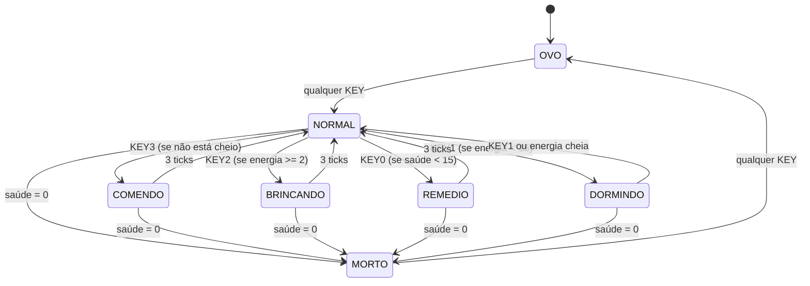

# Bichinho virtual na DE2-115

Projeto final de Lógica Reconfigurável (UTFPR Apucarana, 2026/1): um bichinho
virtual jogável, escrito em VHDL para a placa Terasic DE2-115. Ele aparece no
LCD 16x2 da própria placa.

O jogador cuida de um bichinho que nasce de um ovo. Ele sente fome, fica
entediado e cansado com o passar do tempo; se for negligenciado, adoece e morre.

## Como jogar

| Entrada | Função |
|---|---|
| `KEY3` | Alimentar (+4 de saciedade) |
| `KEY2` | Brincar (+4 de alegria, −2 de energia, −1 de saciedade) |
| `KEY1` | Dormir / acordar (dormindo, a energia sobe) |
| `KEY0` | Remédio (+4 de saúde, −2 de alegria) |
| `SW17` | Reset: volta ao ovo |
| `SW0` | Pausa o tempo do jogo |
| `SW2..SW1` | Velocidade do tempo: `00` 1x, `01` 2x, `10` 4x, `11` 8x |
| `SW3` | Tela do LCD: para baixo, o bichinho; para cima, as informações |

Com o ovo na tela, qualquer `KEY` choca o bichinho. Depois que ele morre,
qualquer `KEY` volta ao ovo.

| Saída | O que mostra |
|---|---|
| LCD 16x2 | Duas telas, escolhidas por `SW3`: o bichinho desenhado, ou as informações (atributos, humor, fase e idade) |
| `HEX7..HEX6` | Idade em "dias" (1 dia = 60 ticks de jogo) |
| `HEX3..HEX0` | Saciedade, alegria, energia e saúde, de `0` a `F` |
| `LEDR` | Piscam quando algum atributo está baixo |
| `LEDG7..0` | Saúde em forma de barra |
| `LEDG8` | Inverte a cada tick de jogo |

Telas do LCD (a chave `SW3` escolhe qual aparece):

**Tela do bichinho** (`SW3` para baixo). Em repouso, mostra só o gatinho, no
centro, sem texto:

| Humor | O que aparece |
|---|---|
| Feliz | o gato pulando, matinhos no chão e brilhos piscando em volta |
| Triste ou doente | o gato parado, só com os matinhos |

Durante uma ação o desenho vai para o canto esquerdo, e o resto da tela mostra
um texto e uma animação:

| Estado | Linha 1 | Linha 2 |
|---|---|---|
| Ovo | `Um ovo!` | `Aperte botao` |
| Evoluiu | `Evoluiu!` por 4 segundos | fase e idade: `Jovem    3d` |
| Comendo | `Nham nham` | três maçãs sendo comidas |
| Brincando | `Brincando!` | bola atravessando a tela |
| Dormindo | `Dormindo` | lua e `z Z z` |
| Remédio | `Remedio` | cruzes piscando |
| Morto (lápide) | `Morreu...` | `com NN dias` |

**Tela de informações** (`SW3` para cima):

| Linha | Conteúdo |
|---|---|
| 1 | ícone e valor (0 a 15) de saciedade, alegria, energia e saúde |
| 2 | alterna a cada 2 segundos entre o humor (`Humor: Feliz`, `Humor: Com fome`...) e a fase com a idade (`Jovem     4 dias`) |

## Evolução

O bichinho é um gatinho, que muda de forma conforme a idade (1 dia = 60 ticks de jogo):

| Fase | Idade | Forma |
|---|---|---|
| Filhote | 0 a 2 dias | gatinho pequeno, de cabeça grande e rabo curto |
| Jovem | 3 a 5 dias | gato sentado, com o rabo subindo ao lado |
| Adulto | 6 dias ou mais | gato grande, com bigodes e rabo comprido |

As idades são os `generic` `JOVEM_AGE` e `ADULTO_AGE` de `pet_core`. Na
velocidade 8x, o bichinho vira adulto em 45 segundos.

## Regras

Os atributos vão de 0 a 15. Um tick de jogo dura 1 s na velocidade 1x.

- Saciedade cai 1 a cada 8 ticks (a cada 16 dormindo).
- Alegria cai 1 a cada 10 ticks (não cai dormindo).
- Energia cai 1 a cada 12 ticks acordado e sobe 1 a cada 2 ticks dormindo; com
  a energia cheia ele acorda sozinho.
- A cada 4 ticks a saúde é avaliada: cai 1 se saciedade, alegria ou energia
  estiver em zero; sobe 1 se as três estiverem acima de 4.
- Saúde em zero: o bichinho morre.

Todos esses valores são `generic` de `pet_core`.

## Máquina de estados



## Arquitetura

```
bichinho_top
├── debounce (x4)   sincroniza e filtra cada KEY; gera um pulso por toque
├── pet_core        base de tempo, máquina de estados e atributos
└── pet_lcd         monta o texto de cada tela
    └── lcd_driver  inicializa o LCD (HD44780) e reescreve as linhas
```

| Arquivo | Conteúdo |
|---|---|
| [src/pet_pkg.vhd](src/pet_pkg.vhd) | Tipos, funções, ícones e os desenhos do bichinho |
| [src/pet_core.vhd](src/pet_core.vhd) | Regras do jogo: ticks, máquina de estados, atributos e evolução |
| [src/pet_lcd.vhd](src/pet_lcd.vhd) | Entidades `lcd_driver` e `pet_lcd` |
| [src/bichinho_top.vhd](src/bichinho_top.vhd) | Entidades `debounce` e `bichinho_top` (portas da DE2-115) |
| [sim/tb_pet_core.vhd](sim/tb_pet_core.vhd) | Testbench autoverificável de `pet_core` |
| `bichinho_virtual.qpf`, `.qsf`, `.sdc` | Projeto Quartus, pinagem e restrições de tempo |

Pontos de projeto:

- **Desenhos como texto.** Os ícones (5x8) e as formas do bichinho (15x16)
  são escritos em `pet_pkg` como linhas de texto (`#` aceso). As funções
  `to_glyph` e `to_sprite` convertem para bits na elaboração.
- **Desenhos grandes no LCD de texto.** O LCD só aceita 8 caracteres
  personalizados de 5x8. Cada forma do bichinho é recortada em 6 deles
  (`sprite_piece`), e o `lcd_driver` regrava os 8 caracteres a cada volta, o
  que permite trocar de desenho e animar (o pulinho desloca o desenho um ponto).
- **LCD sempre atualizado.** O `lcd_driver` reescreve caracteres e linhas sem
  parar (cerca de 40 vezes por segundo); o resto do projeto só muda o conteúdo.
- **Tempo ajustável.** O contador de ticks avança 1, 2, 4 ou 8 por ciclo de
  clock, conforme `SW2..SW1`, sem precisar de vários divisores.
- **Tudo parametrizado.** Períodos, ganhos e custos das ações são `generic`.

## Compilar e gravar

1. Abra `bichinho_virtual.qpf` (na raiz do repositório) no Quartus Prime.
2. *Processing → Start Compilation*.
3. *Tools → Programmer*, selecione `output_files/bichinho_virtual.sof` e grave
   (placa em modo `RUN`, cabo na porta USB-Blaster).
4. O bichinho aparece no LCD da placa.

## Simular

No ModelSim/Questa, a partir da pasta `sim`:

```
do run.do
```

Com GHDL, a partir da raiz:

```
ghdl -a src/pet_pkg.vhd src/pet_core.vhd sim/tb_pet_core.vhd
ghdl -e tb_pet_core
ghdl -r tb_pet_core --wave=sim/tb_pet_core.ghw
```

O testbench passa se não aparecer nenhuma mensagem `FALHA`.
